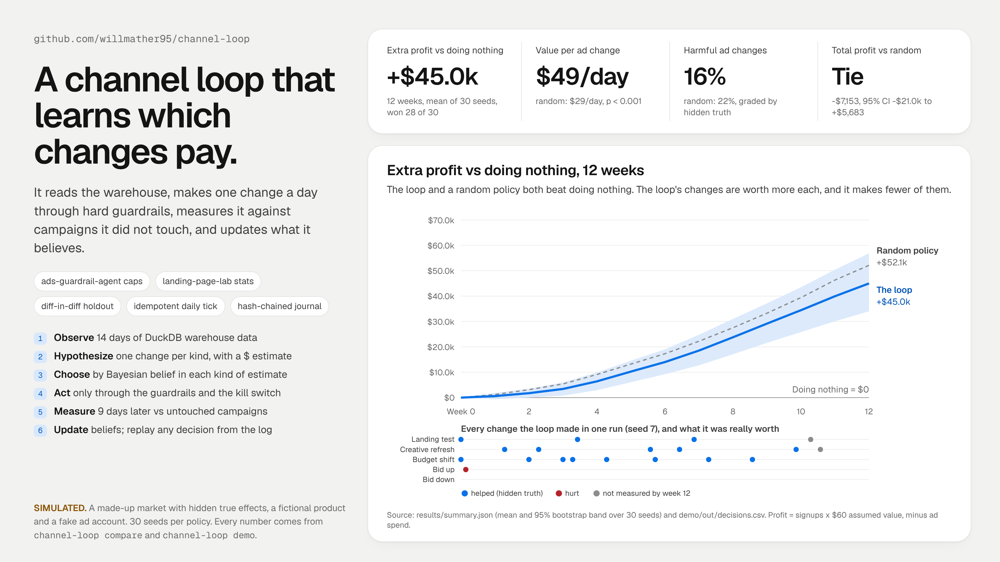
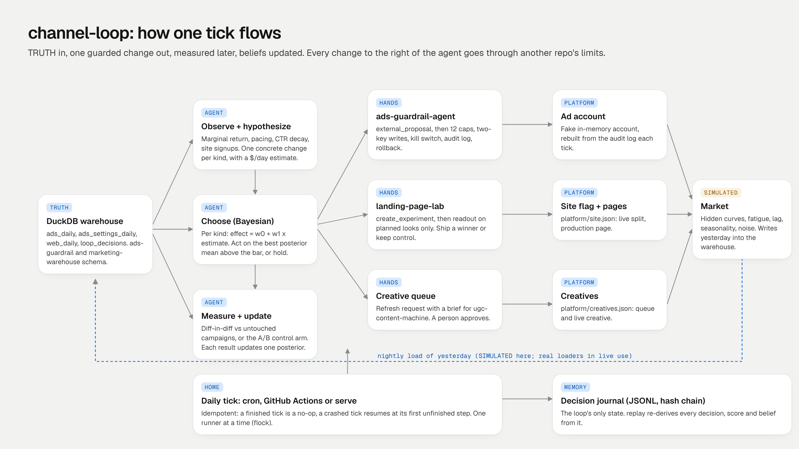
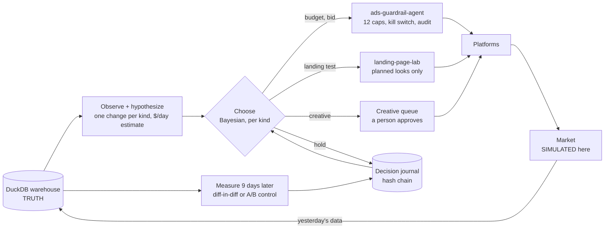

# channel-loop

**A paid-channel loop that reads the warehouse, makes one guarded change a day, measures it against campaigns it did not touch, and learns which kinds of change are worth making.**



> **What's real and what isn't**
>
> | Part | Status |
> |---|---|
> | Tick, agent (observe, hypothesize, choose, measure, update), journal, replay, scheduler, CLI | **Real, working code.** Tested (51 tests). |
> | HANDS: ad changes and landing-page tests | **Real calls into [ads-guardrail-agent](https://github.com/willmather95/ads-guardrail-agent) and [landing-page-lab](https://github.com/willmather95/landing-page-lab)**, imported as packages. Their caps, kill switch, audit log, rollback and stats gates are the ones in those repos, not copies. |
> | Ad account the writes land in | **Fake.** ads-guardrail-agent's in-memory account, rebuilt from its audit log every tick. No ad platform is called. |
> | Landing-page flag, production page, creative queue | **Local JSON files** standing in for a flag service, a host and a person who approves creative. PostHog calls are dry-run (landing-page-lab's own dry-run client). |
> | DuckDB warehouse | **Real DuckDB.** Same `ads_daily` schema as ads-guardrail-agent and the conventions of [marketing-warehouse](https://github.com/willmather95/marketing-warehouse). Filled with **simulated** data. |
> | Market: campaigns, visitors, signups, seasonality, every number in the hero and Results | **SIMULATED.** Made-up response curves with hidden true effects. The product (Fieldnote) and its account are **fictional**. |
> | "Truth" used to grade decisions | **Only exists because it is a simulation.** The agent never sees it. A test checks that agent code never imports the simulator. |
>
> No ad spend, no live writes, no network calls, no API keys.

## Which part of the agent stack this is

Cody Schneider's frame for a marketing agent has four parts: **TRUTH** (live warehouse data), **HANDS** (ad and CMS APIs behind limits), a **HOME** (it runs on a schedule, all the time) and **TOOLS**. On top of those, the channel system should improve itself from the data stream.

This repo is the capstone that ties them together, and it is mostly the last part: **the loop that improves itself**.

| | What this repo supplies |
|---|---|
| **TRUTH** | A DuckDB warehouse the agent reads and nothing else: ad metrics, daily settings, landing-page sessions and signups by variant, and its own decision history (`loop_decisions`). |
| **HANDS** | Borrowed, on purpose. Budget and bid changes go through ads-guardrail-agent's 12 guardrails. Landing-page tests go through landing-page-lab. Creative refreshes go to an approval queue. |
| **HOME** | An idempotent daily `tick`, `catch-up` for missed days, a long-running `serve`, a process lock, and cron and GitHub Actions examples. |
| **TOOLS** | `channel-loop` CLI, plus `Loop`, `run_matrix` and `replay` in Python. |
| **Self-improving** | A Bayesian model per kind of change that learns how far to trust its own estimates, from measurements with a holdout. |

## Quickstart (no credentials, about 2 minutes)

Python 3.12+. The two sibling repos install from pinned git URLs in `requirements.txt`.

```bash
git clone https://github.com/willmather95/channel-loop && cd channel-loop
python3 -m venv .venv && .venv/bin/pip install -r requirements.txt && .venv/bin/pip install -e . --no-deps
.venv/bin/channel-loop demo           # 12 simulated weeks, loop vs doing nothing, one seed (~30 s)
.venv/bin/python -m pytest            # 51 tests (~2 min; -m "not slow" skips the many-seed test)
```

Working on the siblings too? Clone them next to this repo and use `requirements-local.txt` instead. It installs `../ads-guardrail-agent` and `../landing-page-lab` in editable mode. `make install` picks the local file when the folders exist.

What `channel-loop demo` prints (real output, trimmed):

```
SIMULATED: 12 weeks from 2026-09-07, seed 7. Fictional account, fake ad account, no network.

Decisions the loop made (acted on), with what it measured and the hidden truth:
day        arm              target                                                estimate         measured    truth
2026-09-07 budget_shift     Meta | Clinic Owners Prospecting -> Meta | Site Reta       +56      +33 +/- 122       +8
2026-09-07 landing_test     /trial hero test                                          +222     +943 +/- 343     +788
2026-09-08 bid_up           Meta | Lookalike 2%                                        +16      -171 +/- 48      -24
2026-09-16 creative_refresh Meta | Site Retargeting                                    +35       -55 +/- 99     +155
...
profit over 12 weeks: loop $341,269, doing nothing $243,403, difference $97,865 (one seed; see `compare` for many)
actions: 19; proposals blocked by guardrails: 0; ad writes through ads-guardrail-agent: 17; landing winners shipped: 2
journal: chain: 910 records, chain intact; decisions re-derived: 168/168 match
```

One seed is an anecdote. The many-seed comparison behind the hero:

```bash
.venv/bin/channel-loop compare --seeds 30      # 150 runs; about 5 minutes on 8 cores
```

Running it on a schedule, by hand:

```bash
channel-loop init --state state --seed 7
channel-loop tick --state state --date 2026-09-07       # one day; running it again is a no-op
channel-loop catch-up --state state --through 2026-09-20
channel-loop journal replay --state state               # re-derive every decision from the log
channel-loop kill on --state state                      # stop every change the loop makes
```

## How it works





Each day the `tick` does these steps in order. Each step is logged before the next one starts.

**1. Ingest.** Yesterday's data lands in the warehouse. Here the simulated market makes it. In live use, the nightly loaders from marketing-warehouse would. Loads delete the day and insert it again, so a reload never double counts.

**2. Read the landing test.** If a test is live and a planned look day has come, call landing-page-lab's `readout()` with the plan's split and control. It calls a winner only when the Bayesian and sequential gates agree and the sample ratio is fine. A winner ships, or control stays.

**3. Measure.** Any change whose window has closed gets measured (see Attribution below). The result is evidence for one kind of change.

**4. Observe and hypothesize.** From 14 days of warehouse data, the agent writes at most one concrete candidate per kind of change, each with its own estimate in dollars of profit per day.

| Kind | When it is a candidate | Its own estimate |
|---|---|---|
| `budget_shift` | Two campaigns in one account differ in estimated marginal return by 0.25+ | $60 x the gap |
| `bid_up` | Campaign spends under 80% of budget and its marginal dollar returns more than $1 | extra spend x (return - 1) |
| `bid_down` | Campaign spends 95%+ of budget and its marginal dollar returns under $0.90 | 10% of spend x (1 - return) |
| `creative_refresh` | CTR is under 85% of the creative's own best week, no refresh in 21 days | half the lost signups come back |
| `landing_test` | No test live, 3 days since the last one | 5% of site signups (a prior) |

Marginal return is 0.7 x (conversion value / spend). That shared 0.7 is a guess. The real curves differ by campaign. That gap is the point: the loop has to learn how wrong each estimate tends to be.

**5. Choose.** Ad changes and the landing page are two separate slots, because they use different resources. For each kind of change the loop keeps a small Bayesian linear model:

```
measured effect = w0 + w1 x (its own estimate) + noise
```

The prior says "trust my estimates" (w1 = 1, w0 = 0). Every measurement updates it exactly (conjugate Gaussian), weighted by that measurement's own standard error. The loop acts on the candidate with the best posterior-mean effect, if that effect clears $15/day for each campaign it locks. Otherwise it holds. `loop_ts` is the same model with Thompson sampling, kept as an ablation (see Results).

**6. Act, only through other repos' limits.** A budget shift becomes two `external_proposal`s in ads-guardrail-agent. Its caps may clamp each side differently, so the loop sizes both sides to the smaller allowed move. If only one side lands, ads-guardrail-agent's `rollback` undoes it. A landing test is `create_experiment()` in landing-page-lab. A refresh is a queued request with a brief for [ugc-content-machine](https://github.com/willmather95/ugc-content-machine). Every action is logged with its candidates, scores, beliefs and rng seed.

**Attribution.** A changed campaign is compared with campaigns that did not change in the window: a ratio difference-in-differences on value and spend. Pre window: 7 days before. The day after is skipped for conversion lag. Post window: the 7 days after that. Weekday mix, the Thanksgiving dip, landing-page wins and shared demand shocks cancel out. The standard error comes from a day-level bootstrap. If no clean control is left, it falls back to pre/post, says so in the journal, and doubles the error. Landing tests are measured by their own randomized control arm. While a change is being measured, its campaigns are locked so nothing else muddies the result.

**The journal is the only state.** Every tick rebuilds what it needs (open changes, locks, evidence, the live test) by replaying a hash-chained JSONL log. It uses ads-guardrail-agent's log format. So:

- A finished tick is a no-op.
- A crashed tick resumes at its first unfinished step, and no write happens twice (tested by crashing in three places).
- `journal replay` rebuilds each decision from only the evidence before it, then checks that the chosen change, every score and every belief match the log. A forger who edits a measurement and re-computes the hash chain still fails replay (tested).

## Safety and limits

- **Every ad write passes ads-guardrail-agent's 12 caps** (allowlist, cooldown, per-change % and $ caps, floors, daily and total account caps, whole cents). For the simulated account they are in [`config/guardrail.toml`](config/guardrail.toml): 20% or $60 per budget change, 15% or $6 per bid, $200 per account per day, 72-hour cooldown. Brand search is not on the allowlist, so the loop cannot touch it. A test re-checks every write in four runs from the audit log alone.
- **Two keys to write.** `apply = true` in `config/loop.toml` and `[writes] enabled = true` in the guardrail config. With either off, every action is a dry run (tested: no writes, no test launched, account unchanged).
- **Kill switch.** `channel-loop kill on` or `CHANNEL_LOOP_KILL=1`. It is checked before every action of every kind, and ads-guardrail-agent checks it again before each write. A shift cut in half by the kill switch is rolled back on the first tick after release. Rollbacks respect the switch too.
- **One landing test at a time, read only on planned look days.** A winner ships only when landing-page-lab's gates agree. Shipping to production and uploading creative need a person in live use. In the simulator those approvals are simulated and logged as such.
- **Limits I know about.**
  - The live wiring stops at the sibling repos' adapters. The CLI here only runs the simulated account. I have not run this against a real account.
  - The $60 value per signup is an assumption in config.
  - Creative production cost and the cost of losing arms during a landing test are not counted in "measured effect". They are in the simulated profit totals.
  - Twelve weeks is short for learning. Each run collects only a few measurements per kind of change (see Results).

## Results (SIMULATED, from `channel-loop compare --seeds 30`)

Every number here comes from running this repo on a simulated market. That covers 30 seeds, 5 policies and 12 weeks each (Sep 7 to Nov 29, 2026, Thanksgiving week included). All policies go through the same ticks, guardrails and measurement. Pairs share a seed, so they face the same hidden market and the same daily noise. Tests are one-sided sign-flip permutation tests with bootstrap 95% intervals. The full output is in [`docs/results-summary.json`](docs/results-summary.json). The run is deterministic.

Policies: **loop** (the default), **loop_ts** (same beliefs, Thompson sampling), **greedy** (acts on its own estimates, never learns, same $15 bar), **random** (uniform over the same candidates and hold) and **static** (never changes anything).

**Profit over 12 weeks, paired by seed:**

| vs doing nothing | mean | 95% CI | p | seeds won |
|---|---:|---|---:|---:|
| loop | **+$44,982** | +$33,818 to +$56,750 | < 0.0001 | 28 / 30 |
| loop_ts | +$45,367 | +$35,127 to +$56,062 | < 0.0001 | 29 / 30 |
| greedy | +$44,555 | +$32,900 to +$57,051 | < 0.0001 | 29 / 30 |
| random | +$52,134 | +$38,752 to +$68,195 | < 0.0001 | 30 / 30 |

| loop vs | mean | 95% CI | p |
|---|---:|---|---:|
| random | -$7,153 | -$21,035 to +$5,683 | 0.84 |
| greedy | +$426 | -$2,531 to +$3,788 | 0.41 |

**On total profit, the loop does not beat random or greedy over 12 weeks.** Any policy that acts beats doing nothing by a wide margin. That is mostly the landing-page tests, which every policy launches the same way. Whether a test ships a winner, and how big, is largely traffic luck. That luck swings totals more than the ad choices do. Random happened to ship more winners (0.97 per run vs 0.83).

**Where learning shows: the quality of each ad change.** The simulator knows the true effect of every change. Graded by that hidden truth, with landing tests left out:

| policy | ad changes per run | true value per change | harmful | weeks 1 to 6 | weeks 7 to 12 |
|---|---:|---:|---:|---:|---:|
| **loop** | 12.1 | **$49/day** | **16%** | $47 | **$53** |
| loop_ts | 18.2 | $31/day | 21% | $31 | $32 |
| greedy | 15.0 | $38/day | 19% | $41 | $31 |
| random | 18.7 | $29/day | 22% | $30 | $29 |

Per change, paired by seed: loop beats random by **$18/day** (95% CI $13 to $23, p < 0.0001, 27 of 30 seeds). It beats greedy by **$10/day** ($6 to $15, p < 0.0001, 24 of 30). It beats Thompson sampling by **$16/day** ($11 to $20, 26 of 30). The loop makes fewer changes, better ones, and gets better in the second half while greedy gets worse.

**What it learned.** Its estimates are wrong in a consistent way per kind of change. The truth means come from 445 graded loop decisions.

| kind | its own estimate (mean) | hidden truth (mean) | where the beliefs moved |
|---|---:|---:|---|
| budget_shift | $56/day | $17/day | down: w0 -0.10, w1 0.84 |
| bid_up | $37/day | $1/day | down: w0 -0.15, w1 0.92 |
| creative_refresh | $46/day | $148/day | up: w0 +0.16, w1 1.09 |

It moves the right way, but only part way. Each run has only zero to six measurements per kind (bid cuts are rare), and the noise is large. Its measurements track the truth with r = 0.86 across 445 decisions, and the 95% interval covered the truth 91% of the time (a little under 95%). Mean absolute error was $109/day.

**Why the default is posterior-mean, not Thompson sampling.** I built Thompson first. Over 12 weeks its exploration cost more than it earned: more changes, lower value each, and a higher harmful share. With a short horizon and a few measurements per run, exploiting what the evidence says beats exploring. A loop that runs for a year would likely want some exploration back. I have not tested that here.

## Tests

```bash
.venv/bin/python -m pytest              # 51 passed (~2 min on 8 cores)
.venv/bin/python -m pytest -m "not slow"   # 45, skips the many-seed test
```

| File | What it proves |
|---|---|
| `test_tick_idempotency.py` | A finished tick is a no-op (journal, audit and warehouse unchanged). A fresh process sees the same state. Ticks cannot go backwards. A crash inside readout, measure, or right after a write resumes to the same decisions, actions and writes as a run that never crashed. Catch-up fills gaps in order. The runner lock blocks a second runner. |
| `test_guardrails_e2e.py` | **Guardrails hold end to end.** Every write in four 5-week runs (loop and random) is re-checked from the audit log alone: allowlist, per-change caps, floors, cents, 72h cooldown, daily and total account caps. Shifts are symmetric. One landing test at a time, read only on planned days. Kill switch by file and by env stops every kind of change, and release resumes. Write switch off means dry run with the account untouched. Locked campaigns are never changed mid-measurement. |
| `test_learning.py` | **The loop learns, as a statistical test across 8 seeds.** It beats doing nothing (p < 0.01). Its ad changes are worth more than random ones by the hidden truth (p < 0.01). Its beliefs move toward the truth for shifts, bid raises and refreshes. Every journal is intact. Total profit vs random is not asserted, because it does not hold. |
| `test_journal_replay.py` | **Journal replay** re-derives every decision in four runs. A fresh read equals the live state. A naive edit breaks the hash chain. A forged edit with a re-computed chain still fails replay. Agent code never imports the simulator. |
| `test_bandit_stats.py` | The posterior equals the closed-form conjugate update. Evidence moves predictions toward the truth and narrows them. Choices are deterministic per seed. The per-campaign bar works. The posterior-mean policy drops an arm it learned is harmful, and greedy cannot. The sign-flip test is exact. |
| `test_market_measure.py` | The simulator is deterministic, with diminishing returns, pacing, fatigue, a Thanksgiving dip and lag that conserves conversions. Warehouse loads are idempotent and readable by ads-guardrail-agent's own `WarehouseReader`. Diff-in-diff recovers a known effect (+80, -50, 0) through a demand shock where naive pre/post fails, and it flags the no-control fallback. |
| `test_cli.py` | `init`, `tick`, `catch-up`, `serve`, `journal verify / replay / show`, `kill` and their exit codes. |

CI runs the tests and the demo on Python 3.12 and 3.13 ([`.github/workflows/ci.yml`](.github/workflows/ci.yml)). It needs no secrets.

## Layout

```
src/channel_loop/
  loop.py            the tick: ingest, readout, measure, decide, act; steps logged and resumable
  journal.py         hash-chained decision journal and state replay (the only state)
  replay.py          re-derive and check every past decision
  warehouse.py       DuckDB TRUTH layer (ads-guardrail-agent DDL + web, settings, loop tables)
  agent/             hypotheses.py (observe + candidates), bandit.py (beliefs + choice), measure.py (DiD, A/B)
  hands/             ads.py (ads-guardrail-agent), landing.py (landing-page-lab), creative.py (queue)
  home/runner.py     catch-up, serve, process lock, state meta
  sim/               market.py (SIMULATED market), source.py (nightly load stand-in), truth.py (grading only)
  experiment.py      many seeds x policies, paired stats, decision quality
  platform.py        flag, site and creative state files (stand-ins for outside systems)
  world.py           the fictional account: 2 ad accounts, 8 campaigns
config/              loop.toml, guardrail.toml (ads-guardrail-agent caps), brief.yaml (landing-page-lab)
examples/            crontab.txt, github-actions-daily.yml (HOME)
scripts/render.py    docs/hero.png and docs/architecture.png from the repo's own outputs
docs/                hero, architecture, results-summary.json, demo-summary.json, demo-decisions.csv
```

Re-render the images with `make compare demo hero` (needs Chrome, or set `CHROME_PATH`).

## Related repos

- [ads-guardrail-agent](https://github.com/willmather95/ads-guardrail-agent): the HANDS for every budget and bid change, with its caps, kill switch and audit log
- [landing-page-lab](https://github.com/willmather95/landing-page-lab): the HANDS for landing-page tests, and the stats that decide them
- [marketing-warehouse](https://github.com/willmather95/marketing-warehouse): the DuckDB TRUTH conventions this warehouse follows
- [ugc-content-machine](https://github.com/willmather95/ugc-content-machine): where a creative refresh request would go
- [conversion-tracking-agent](https://github.com/willmather95/conversion-tracking-agent): makes sure the signups this optimizes on are counted once
- [agent-ops-showcase](https://github.com/willmather95/agent-ops-showcase): how I run agents with owner approval and receipts
- [world-class-charts](https://github.com/willmather95/world-class-charts): the chart rules behind the hero image

## License

MIT. See [LICENSE](LICENSE).
